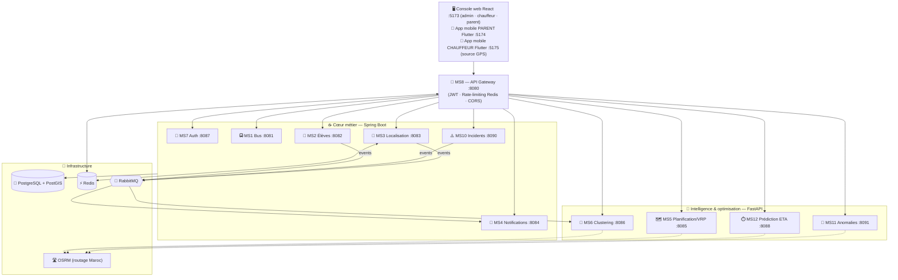

<div align="center">

# 🚌 Transport Scolaire Intelligent

### Plateforme microservices pour la digitalisation et l'optimisation du transport scolaire
**Meknès, Maroc — 300 élèves géolocalisés (données GPS réelles)**

[](https://openjdk.org/projects/jdk/21/)
[](https://spring.io/projects/spring-boot)
[](https://www.python.org/)
[](https://fastapi.tiangolo.com/)
[](https://www.postgresql.org/)
[](https://www.docker.com/)
[](https://flutter.dev/)
[](#-tests)
[](#-tests)

*Projet de Fin d'Études — Master SDIA (Systèmes Distribués & Intelligence Artificielle)*
*Faculté des Sciences Moulay Ismail, Meknès*

</div>

---

## 📖 Présentation

**Transport Scolaire Intelligent** est un système distribué qui digitalise l'ensemble de la chaîne du transport
scolaire — de la gestion des bus et des élèves au suivi GPS temps réel, en passant par l'**optimisation par
intelligence artificielle** des groupes de ramassage, des tournées et de la prédiction des temps d'arrivée.

L'architecture repose sur **12 microservices** répartis en deux écosystèmes complémentaires :

- **Cœur métier (Java / Spring Boot)** — authentification, bus, élèves, localisation, incidents, notifications, passerelle API.
- **Intelligence & optimisation (Python / FastAPI)** — clustering capacitaire, planification de tournées (VRP),
  prédiction d'ETA et détection d'anomalies, chacun développé selon une démarche **data-science rigoureuse (CRISP-DM)**.

> 💡 **Fil rouge scientifique du projet :** chaque brique d'IA est justifiée par un **benchmark honnête**
> (plusieurs modèles comparés, protocole d'évaluation sérieux, limites assumées) — pas un simple appel de bibliothèque.

---

## 🏗️ Architecture



---

## 🧩 Microservices

### ☕ Cœur métier (Java 21 / Spring Boot 3.5)

| # | Service | Port | Rôle |
|---|---------|:----:|------|
| **MS7** | **AuthService** | `8087` | Authentification JWT (register / login / validate), **gestion des utilisateurs** (CRUD ADMIN, sans exposer les mots de passe), RBAC `ADMIN·CHAUFFEUR·PARENT` |
| **MS1** | **BusService** | `8081` | CRUD flotte, statut (`ACTIF·INACTIF·EN_PANNE`), position |
| **MS2** | **EleveService** | `8082` | CRUD élèves, affectation bus/groupe, présence, événements RabbitMQ |
| **MS3** | **LocalisationService** | `8083` | GPS temps réel via **WebSocket**, cache Redis, routage OSRM |
| **MS4** | **NotificationService** | `8084` | Notifications push **FCM** (Firebase), historique, statistiques |
| **MS10** | **IncidentService** | `8090` | Cycle de vie des incidents (`SIGNALE→…→RESOLU`), publication d'événements |
| **MS8** | **API Gateway** | `8080` | Point d'entrée unique : validation JWT, rate-limiting Redis, CORS global |

### 🐍 Intelligence & optimisation (Python 3.11 / FastAPI)

| # | Service | Port | Rôle & modèle |
|---|---------|:----:|---------------|
| **MS6** | **ClusteringService** | `8086` | **Affectation élèves→bus** : k-médoïdes **capacitaire** sur distance **routière OSRM**, projection **UTM 30N**, affectation globale par **programmation linéaire**, sélection du nombre de bus par **Pareto** |
| **MS5** | **PlanificationService (VRP)** | `8085` | **Ordre de tournée optimal** par bus : **TSP OR-Tools**, dépôt = école, distances OSRM réelles, gain mesuré vs baseline |
| **MS12** | **PredictionService (ETA)** | `8088` | **Prédiction du temps d'arrivée** : benchmark multi-modèles, dataset semi-réel ancré OSRM (180 j), split temporel |
| **MS11** | **AnalytiqueService (Anomalies)** | `8091` | **Détection d'anomalies** de trajet : Isolation Forest curé, feature `surprise` contextuelle, évaluation PR-AUC/ROC |
| **MS9** | **Assistant LLM (parent + admin)** | `8089` | **Agent tool-calling** (sans LangChain), **agnostique** (cascade Groq 70b→8b→Gemini) : le parent demande position/ETA/présence/incidents ; outils scopés à ses enfants (JWT), reverse geocoding OSM, **FR/AR/darija**. **Phase B — NL2SQL admin** : question en langage naturel → SQL → synthèse, avec un **rôle Postgres `ms9_readonly`** et une transaction `READ ONLY` (la sécurité est dans la base, pas seulement dans le prompt) |

> `ms-common` est un module Java partagé (JWT, rôles) sans dépendance Spring.

---

## 🖥️ Interfaces web — 3 rôles (web-admin)

Application **React 18 + Vite + TypeScript** (gestionnaire **Bun**, **Tailwind CSS v4**, react-leaflet, Recharts),
consommant exclusivement la **Gateway** (JWT) et le **WebSocket GPS**. Design **« signalétique / plan de transport »**
distinctif (thème clair/sombre), code-splitting par route, **RBAC par rôle : ADMIN · CHAUFFEUR · PARENT** (menu et
routes filtrés). Dossier [`frontend/web-admin/`](frontend/web-admin/).

**Espace ADMIN**

| Page | Contenu |
|------|---------|
| **Tableau de bord** | KPIs temps réel, anomalies live, santé des briques IA, **graphiques** (Recharts), auto-refresh |
| **Carte live** | Bus en temps réel (**mouvement interpolé**, traînées, flèches de sens, arrêts numérotés, **pulse d'anomalie**, **ETA live → école**), tournées OSRM |
| **Clustering** | Lancer/appliquer, **Pareto**, diagnostics, verdict qualité, **carte des clusters** (enveloppes convexes + filtres) : dernier résultat DB **+ carte de prévisualisation** d'une simulation |
| **Prévisions ETA** | Heure d'arrivée estimée **à chaque arrêt** d'une tournée (ramassage / dépose) |
| **Trajets en cours** | Tableau live des chauffeurs en tournée (temps réel) |
| **Incidents · Analytique · Notifications** | Suivi des incidents (MS10), scan d'anomalies (MS11), journal des notifications |
| **Messagerie** | Conversations **admin ↔ chauffeurs** (chat + non-lus) |
| **Élèves · Bus · Utilisateurs** | **CRUD complet** ; liaison **parent↔enfant** et **chauffeur↔bus** ; présence ; pagination/tri ; export **CSV** |
| **Paramètres** | Préférences (défauts clustering) + seuils backend |

**Espace CHAUFFEUR** — Ma tournée (cycle de vie **Trajet** démarrer/terminer, **pointage** montée/dépose, **arrêt
courant** + distance, ETA), Carte/ETA de son bus, Mes incidents, **Messagerie** (↔ admin + **diffusion aux parents**
de son groupe), Mes notifications, **Mes trajets** (historique).

**Espace PARENT** — Mon espace (enfants + bus + présence + **compte à rebours « bus arrive dans ~N min »** vers
l'école le matin / le domicile le soir, **si un trajet est démarré**), Carte de mon enfant (bus filtré + ETA),
Messagerie (**réception** des diffusions), Notifications.

**Déviation d'itinéraire (UC-8)** : au démarrage d'un trajet, la tournée (géométrie OSRM) est figée ; **MS11**
surveille l'écart position ↔ route et lève une anomalie `DEVIATION_ITINERAIRE`.

> Finition « produit » : toasts, error boundary, skeletons, modales de confirmation, **command palette ⌘K**,
> navigation mobile. Panneau de tests e2e : [`html_tests/simulation-control.html`](html_tests/simulation-control.html)
> (pilote tous les scénarios ciblés sur un chauffeur/bus et s'observe dans les pages React).

---

## 📱 App mobile PARENT (Flutter)

Application **Flutter 3.44 / Dart 3.12** ([`frontend/parent-mobile/`](frontend/parent-mobile/)) qui **reprend les 5
écrans de l'espace parent web** en consommant le **même backend** (Gateway `:8080` + WebSocket GPS `:8083`) —
**aucun delta backend** (endpoints déjà ouverts au rôle PARENT, CORS Gateway `*`). Cible dev **Chrome web** `:5174`,
code **Android-ready** (`usesCleartextTraffic`, IP LAN via `--dart-define`).

| Écran | Contenu |
|-------|---------|
| **Login** | JWT (`flutter_secure_storage`), 401 → déconnexion auto |
| **Mon espace** | Enfants · présence · bus + **compte à rebours** ETA (gaté sur trajet démarré, matin→école / soir→domicile) |
| **Carte de mon enfant** | `flutter_map` OSM/CARTO, bus filtrés aux enfants, **glisse interpolée** entre pings GPS, ETA→école, tuiles sombres |
| **Messagerie** | Réception des diffusions chauffeur (poll 15 s) |
| **Notifications** | Historique personnel (poll 15 s) |
| **Assistant** | Chat MS9 `POST /api/llm/chat` (FR/AR) + badge non-lus |

**Tech** : `dio` (Bearer, timeouts 20 s / 120 s ETA+LLM), `web_socket_channel` (auto-reconnect + throttle),
`flutter_riverpod` (auth/enfants/GPS partagés). **UI/UX + perf** (skill `flutter-ui-ux`) : **Material 3 clair + sombre**
avec toggle, tokens 4/8 pt, skeletons shimmer, countdown animé, `RepaintBoundary` / `const` / `ListView.builder`,
`Semantics` (lecteurs d'écran). **Qualité** : `flutter analyze` 0 issue · `flutter test` **25/25**.

> L'écran **Prévisions ETA** (6ᵉ onglet) donne l'heure de passage estimée par enfant : sens matin/soir + heure de
> départ → rang dans la tournée et heure d'arrivée, via `POST /api/planification/mes-enfants` (portée imposée par
> le JWT : MS5 planifie la tournée entière mais ne renvoie que les étapes des enfants du demandeur).

---

## 🚐 App mobile CHAUFFEUR (Flutter)

Application **Flutter** ([`frontend/chauffeur-mobile/`](frontend/chauffeur-mobile/)) qui reprend les **7 écrans de
l'espace chauffeur web**. Cible dev **Chrome** `:5175`, code **Android-ready**. **Aucun delta backend.**

**Ce qui la distingue de l'app parent : elle ÉCRIT, et le téléphone devient la source GPS du bus.**

| Écran | Contenu |
|-------|---------|
| **Ma tournée** | Cycle de vie du **Trajet** (démarrer/terminer), **pointage** montée/dépose, arrêt courant + distance, KPI **« Fin de tournée »**, interrupteur d'émission GPS |
| **Ma carte** | Position live de **son** bus, tracé de la tournée, arrêts numérotés (verts une fois traités), suivi automatique |
| **Prévisions ETA** | Heure de passage estimée à chaque arrêt (cumul MS5 → MS12) |
| **Mes incidents** | Liste des incidents de son bus + signalement (6 types, position jointe) |
| **Messagerie** | **Bidirectionnelle** avec l'administration + **diffusion aux parents** de son groupe (canaux étanches) |
| **Mes notifications · Mes trajets** | Notifications entrantes · historique des tournées |

### Le téléphone comme source GPS

`POST /api/gps/position` était **déjà ouvert au rôle CHAUFFEUR** côté MS3 — d'où l'absence de delta backend.
L'interrupteur « Transmettre ma position » est **désactivé par défaut** (sinon le téléphone et `bus_simulator.py`
se disputent le même bus) et n'émet **que pendant un trajet** (1 envoi / 5 s, filtre 15 m). L'émission continue
écran verrouillé grâce au `ForegroundNotificationConfig` de `geolocator` — donc **sans**
`ACCESS_BACKGROUND_LOCATION` ni second isolate.

> ⚠️ `geolocator` renvoie des **m/s**, `bus_simulator.py` publie des **km/h** et le seuil MS11 vaut **90 km/h** :
> la conversion ×3,6 est indispensable, faute de quoi `VITESSE_EXCESSIVE` ne partirait jamais d'un vrai téléphone.

### File d'écritures hors ligne — un chauffeur roule

Toutes les écritures passent par une file **FIFO stricte, single-flight**, persistée (`shared_preferences`) et
donc **survivant à la fermeture de l'app**. La sémantique dépend du type d'écriture :

| Écriture | Idempotente ? | Traitement au rejeu |
|---|---|---|
| Présence | ✅ valeur absolue (`?present=`) | Les pointages successifs d'un même élève sont **fusionnés** |
| Démarrer un trajet | ❌ MS1 renvoie `400` si un trajet est déjà en cours | **Réconciliation** : on relit `mon-actif` et on **adopte** le trajet existant |
| Incident · message · diffusion | ❌ aucune clé serveur | **At-least-once assumé** : plafond de 3 essais, puis la décision revient au chauffeur |

Les **positions GPS ne sont jamais rejouées** : `PositionRequest` n'a pas d'horodatage (MS3 date à la réception),
un point réémis deviendrait une **fausse position courante**.

**Démarrer hors ligne est refusé sans itinéraire en cache** : démarrer sans `geometrie` prive MS11 de sa référence
et **désarme la détection de déviation en silence**. Le bouton est désactivé et la raison affichée.

**Qualité** : `flutter analyze` 0 issue · `flutter test` **84/84** — l'app parent exposait un singleton
`Api.instance` qui bornait ses tests au login ; ici tout passe par une interface `ApiClient` injectable, ce qui
permet de tester les écrans à actions, y compris leurs chemins d'échec.

### Configuration multi-cible (sans jamais modifier le code)

Un fichier JSON par environnement dans [`config/`](frontend/parent-mobile/config/), injecté via
`--dart-define-from-file`. **Si l'IP du PC change, seul le JSON est à éditer.**

```bash
cd frontend/parent-mobile && flutter pub get

# Navigateur (backend sur localhost)
flutter run -d chrome --web-port 5174 --dart-define-from-file=config/env.chrome.json

# Téléphone physique (backend sur l'IP LAN du PC + pare-feu 8080/8083 ouvert)
flutter run --dart-define-from-file=config/env.phone.json
```

> Depuis VS Code, toutes les cibles sont lançables **en un clic** via `.vscode/launch.json`
> (« Parent App — Chrome / Téléphone », « Chauffeur App — Chrome / Téléphone »).

L'app chauffeur suit **exactement le même mécanisme**, seul le port web diffère (les deux apps doivent pouvoir
tourner côte à côte pendant une démo) :

```bash
cd frontend/chauffeur-mobile && flutter pub get
flutter run -d chrome --web-port 5175 --dart-define-from-file=config/env.chrome.json
flutter run --dart-define-from-file=config/env.phone.json
```

> ⚠️ `String.fromEnvironment` est une **constante de compilation** : éditer un JSON exige de **relancer** l'app,
> un hot restart ne suffit pas. Et la console web (`web-admin`) suit le même principe avec un mécanisme
> différent — Vite et `import.meta.env.VITE_GATEWAY`, dans un fichier `.env`.

---

## 🔬 Intelligence artificielle — points forts

Chaque service IA suit la même exigence : **comparer plusieurs approches, mesurer honnêtement, assumer les limites.**

<table>
<tr><th>Service</th><th>Problème</th><th>Résultat clé (mesuré)</th></tr>
<tr>
  <td><b>🧩 MS6</b><br/>Clustering</td>
  <td>Répartir 300 élèves en groupes ≤ capacité, géographiquement cohérents</td>
  <td>7 bus · silhouette routière 0.43 · compacité médiane 725 m · <b>taille ≤ capacité garantie par construction</b> (LP)</td>
</tr>
<tr>
  <td><b>🗺️ MS5</b><br/>VRP / Tournées</td>
  <td>Ordre de ramassage optimal par bus</td>
  <td>Gain moyen <b>~12.6 %</b> vs ordre naïf · <b>soir = même ordre que le matin</b> (équité du temps à bord prouvée sur OSRM réel) · <b>benchmark CVRP global</b> sur les 300 élèves : à budget égal il ne bat jamais la décomposition MS6+TSP de plus de 0,2 % — mais il économise <b>1 bus sur 7</b> (6 bus pleins) pour +0,4 % de conduite</td>
</tr>
<tr>
  <td><b>⏱️ MS12</b><br/>Prédiction ETA</td>
  <td>Estimer le temps d'arrivée d'un tronçon</td>
  <td>Gagnant <b>ElasticNet</b> · R² (trajets normaux) 0.82 · MAE 0.86 min · <b>+52.7 %</b> vs baseline OSRM brute</td>
</tr>
<tr>
  <td><b>🔎 MS11</b><br/>Anomalies</td>
  <td>Repérer les trajets anormaux sans supervision</td>
  <td>Gagnant <b>Isolation Forest curé</b> · <b>PR-AUC 0.91</b> · rappel 0.88 · le multivarié bat tout seuil univarié</td>
</tr>
</table>

📄 Le **benchmark CVRP vs MS6+TSP** est expliqué pas à pas dans [`docs/MS5_BENCHMARK_CVRP.md`](docs/MS5_BENCHMARK_CVRP.md) :
pourquoi décomposer un problème d'optimisation peut battre le modèle « tout-en-un », mesuré sur les 300 élèves.

📓 Chaque service embarque ses **notebooks CRISP-DM** (EDA → comparaison de modèles → stratégie de production)
et une **documentation dédiée** dans [`docs/`](docs/).

---

## 🛠️ Stack technique

| Domaine | Technologies |
|---------|--------------|
| **Frontend web** | React 18 · Vite · TypeScript · **Bun** · Tailwind CSS v4 · react-leaflet · Recharts · Axios |
| **Backend Java** | Java 21 · Spring Boot 3.5 · Spring Security 6 · Spring Cloud Gateway (WebFlux) · Maven multi-module |
| **Services IA** | Python 3.11 · FastAPI · Uvicorn · scikit-learn · NumPy/pandas · SciPy (LP) · OR-Tools · pyproj (UTM) · XGBoost/LightGBM |
| **Données** | PostgreSQL 15 + PostGIS |
| **Cache & Messaging** | Redis 7 · RabbitMQ 3 (TopicExchange) |
| **Sécurité** | JWT HMAC-SHA256 (JJWT / PyJWT) · double validation Gateway + service |
| **Géo / Routage** | OSRM (données OSM Maroc) · distances routières réelles |
| **Temps réel** | WebSocket natif Spring · notifications Firebase FCM |
| **Résilience** | Tenacity (retry exponentiel) · `asyncio.Lock` |
| **Conteneurs & Tests** | Docker Compose · Newman (Postman CLI) · Jupyter |

---

## 🚀 Démarrage rapide

### Prérequis
- **Docker & Docker Compose** · **Java 21 + Maven** · **Python 3.11** (environnement conda `nlp` recommandé)
- Conteneur **OSRM** avec les données OSM Maroc (`osrm_meknes`)

### 1. Infrastructure

```bash
docker-compose up -d          # PostgreSQL · Redis · RabbitMQ · pgAdmin
docker start osrm_meknes      # moteur de routage OSRM (port 5000)
```

### 2. Lancement de tous les services

```bash
# Windows — un terminal par microservice
start-all-ms.bat
```

<details>
<summary>Lancement manuel (ordre recommandé)</summary>

```bash
# Java (Spring Boot) — la Gateway en dernier
cd ms7-auth          && mvn spring-boot:run   # :8087
cd ms1-bus           && mvn spring-boot:run   # :8081
cd ms2-eleves        && mvn spring-boot:run   # :8082
cd ms3-localisation  && mvn spring-boot:run   # :8083
cd ms10-incidents    && mvn spring-boot:run   # :8090
cd ms4-notifications && mvn spring-boot:run   # :8084
cd ms8-gateway       && mvn spring-boot:run   # :8080

# Python (FastAPI) — environnement conda "nlp"
cd ms6-clustering    && uvicorn main:app --port 8086 --reload
cd ms5-planification && uvicorn main:app --port 8085 --reload
cd ms12-prediction   && uvicorn main:app --port 8088 --reload
cd ms11-analytique   && uvicorn main:app --port 8091 --reload
```
</details>

### 3. Console d'administration (web-admin)

```bash
cd frontend/web-admin
bun install
bun run dev          # http://localhost:5173  (login admin@transport.ma / Admin123!)
```

### 4. Vérification

```bash
curl http://localhost:8080/api/auth/health      # Gateway → Auth
curl http://localhost:8086/api/clustering/health
```

Ou ouvrez la **console de test unifiée** : [`html_tests/test-console.html`](html_tests/test-console.html)
(authentification, cartes Leaflet des clusters/bus temps réel, clustering, tournées, ETA, anomalies…).

---

## 🔌 Ports

| Service | Port | | Service | Port |
|---------|:----:|-|---------|:----:|
| API Gateway (MS8) | `8080` | | Clustering (MS6) | `8086` |
| Bus (MS1) | `8081` | | Auth (MS7) | `8087` |
| Élèves (MS2) | `8082` | | Prédiction ETA (MS12) | `8088` |
| Localisation (MS3) | `8083` | | **Assistant LLM (MS9)** | `8089` |
| Notifications (MS4) | `8084` | | Incidents (MS10) | `8090` |
| Planification/VRP (MS5) | `8085` | | Anomalies (MS11) | `8091` |
| PostgreSQL `5432` · Redis `6379` · RabbitMQ `5672`/`15672` · OSRM `5000` | | | | |
| **Front** : web-admin `5173` · app parent Flutter `5174` · **app chauffeur Flutter `5175`** | | | | |

---

## 🔁 Événements (RabbitMQ)

Exchange **`transport.exchange`** (topic, durable). Communication asynchrone découplée entre services :

| Routing key | Producteur | Consommateur |
|-------------|:---------:|:------------:|
| `eleve.created` · `eleve.gps.updated` · `eleve.deleted` | MS2 | MS6 (recalcul clustering) |
| `bus.created` · `bus.deleted` | MS1 | MS6 (la flotte change → `k` peut changer) |
| `gps.bus.updated` | MS3 | MS4 (arrivée école) · **MS12** (ETA temps réel) · **MS11** (anomalies live) |
| `eta.bus.arriving` | MS12 | MS4 (« le bus arrive dans ~10 min ») |
| `eleve.presence.updated` | MS2 | MS4 (« enfant à bord » / « déposé ») |
| `trajet.demarre` · `trajet.termine` | MS1 | MS4 (alerte admin) · **MS11** (fige/purge la route de référence) |
| `clustering.quality.low` | MS6 | MS4 (alerte qualité admin) |
| `anomalie.detectee` | MS11 | MS4 (alerte admin) |
| `incident.signale` · `incident.resolu` | MS10 | MS4 (notifications) |

---

## 🔐 Sécurité

- **JWT HMAC-SHA256** émis par MS7, secret partagé par tous les services.
- **Double validation** (defense-in-depth) : la Gateway valide et injecte `X-User-*`, chaque service re-valide.
- **RBAC** : `@PreAuthorize` côté Java, `verify_token` côté Python.
- **CORS** géré **uniquement** par la Gateway ; **rate-limiting** Redis (global + renforcé sur `/auth`).

---

## 🧪 Tests

| Outil | Couverture | Statut |
|-------|-----------|:------:|
| **`e2e_integration_test.py`** | Chaîne complète (clustering→busId→GPS→ETA→notif→présence→anomalie) | **8/8** ✅ |
| **Newman (Postman)** | API cœur métier | **88/88 assertions** ✅ |
| **Console web** | Parcours de bout en bout + cartes | ✅ |
| **`flutter test`** (chauffeur) | Écrans à actions, file hors ligne, primitive ETA sur **tournée réelle** | **84/84** ✅ |
| **`flutter test`** (parent) | Login, primitive ETA (mêmes tests de parité + fixture réelle) | **25/25** ✅ |
| **Notebooks Jupyter** | Validation des modèles IA (CRISP-DM) | ✅ |
| `verify_sens.py` | Preuve d'équité des tournées (OSRM réel) | ✅ |

> **Données de démo** : `generer_comptes.py` (idempotent, `--reset`) crée des familles réalistes (parents/fratries),
> des chauffeurs et une flotte de bus, et exporte les identifiants (`comptes_utilisateurs.csv/json`, gitignorés).

---

## 📂 Structure du projet

```
transport-scolaire/
├── pom.xml                  # parent Maven multi-module
├── docker-compose.yml       # PostgreSQL · Redis · RabbitMQ · pgAdmin
├── start-all-ms.bat         # lancement de tous les services
├── ms-common/               # module Java partagé (JWT, rôles)
├── ms1-bus/ … ms12-prediction/   # 12 microservices
├── frontend/web-admin/      # console web React + Vite + TS (Bun) — admin · chauffeur · parent
├── frontend/parent-mobile/     # app mobile PARENT Flutter (Chrome :5174 / Android)
├── frontend/chauffeur-mobile/  # app mobile CHAUFFEUR Flutter (Chrome :5175 / Android) — source GPS
├── html_tests/              # console de test unifiée + cartes Leaflet
├── bus_simulator.py         # simulateur data-driven (vraies tournées OSRM, présence, anomalies)
├── osrm-data/               # données OSM Maroc pré-traitées
└── docs/                    # documentation détaillée + rapport + planning
```

Chaque service Python contient : `main.py` · modules métier · `notebooks/` (CRISP-DM) · `data/` (artefacts) · `requirements.txt`.

---

## 🗓️ Feuille de route

| Sprint | Contenu | Statut |
|--------|---------|:------:|
| S1–S6 | Conception, infrastructure, Auth, Bus, Élèves, Gateway, GPS/WebSocket, OSRM, Incidents, Notifications | ✅ |
| S7 | **MS6 Clustering** (refonte experte : UTM, k-médoïdes capacitaire routier, Pareto) | ✅ |
| S8 | **MS12 Prédiction ETA** + déclencheurs clustering + **garde-fou qualité** | ✅ |
| — | **Intégration temps réel** : ETA→notif, anomalies GPS live, présence, liaison groupe↔bus (validé e2e 8/8) | ✅ |
| S10 | **MS5 VRP** (TSP OR-Tools, tournées) | ✅ |
| S11 | **Console d'administration web (UC-13)** — React/Vite : dashboard, carte live, clustering (cartes clusters + prévisualisation), CRUD élèves/bus/utilisateurs & liaisons, incidents, anomalies, ETA par arrêt | ✅ |
| S12 | **MS11 Détection d'anomalies** (Isolation Forest curé) + **monitor GPS live** · KPIs | ✅ |
| S9 | **Assistant LLM (MS9)** — **Phase A** agent tool-calling parent (cascade Groq/Gemini, FR/AR/darija) · **Phase B** NL2SQL admin (SQL read-only, page `AdminAssistant`) | ✅ |
| S13+ | **App mobile PARENT Flutter** (`frontend/parent-mobile/`, Chrome :5174 / Android) — 5 écrans miroir de l'espace parent web, Material 3 clair+sombre, carte live glisse GPS, aucun delta backend | ✅ |
| S15 | **App mobile CHAUFFEUR Flutter** (`frontend/chauffeur-mobile/`, Chrome :5175 / Android) — 7 écrans, le téléphone devient la **source GPS**, **file d'écritures hors ligne** persistée, 84 tests | ✅ |
| S15 | **Campagne de correction** issue de l'exécution contre le backend réel : ETA « cycle fermé », MS5 `continue_straight`, 2 crashs d'interface (cf. [CLAUDE.md](CLAUDE.md), pièges 13-15) | ✅ |
| — | Réaffectation dynamique (UC-9) · déploiement Railway/Render | ⏳ |
| S13–S15 | Tests e2e ✅ · déploiement · mémoire & soutenance | 🔄 |

---

## 👤 Auteur

**Anass** — Master SDIA (M2), Faculté des Sciences Moulay Ismail, Meknès
Encadrant : **Pr. Ali Bekri**

<div align="center"><sub>Projet de Fin d'Études · 2026</sub></div>
```
